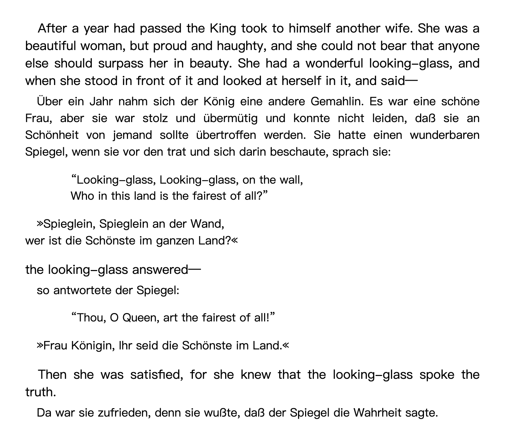
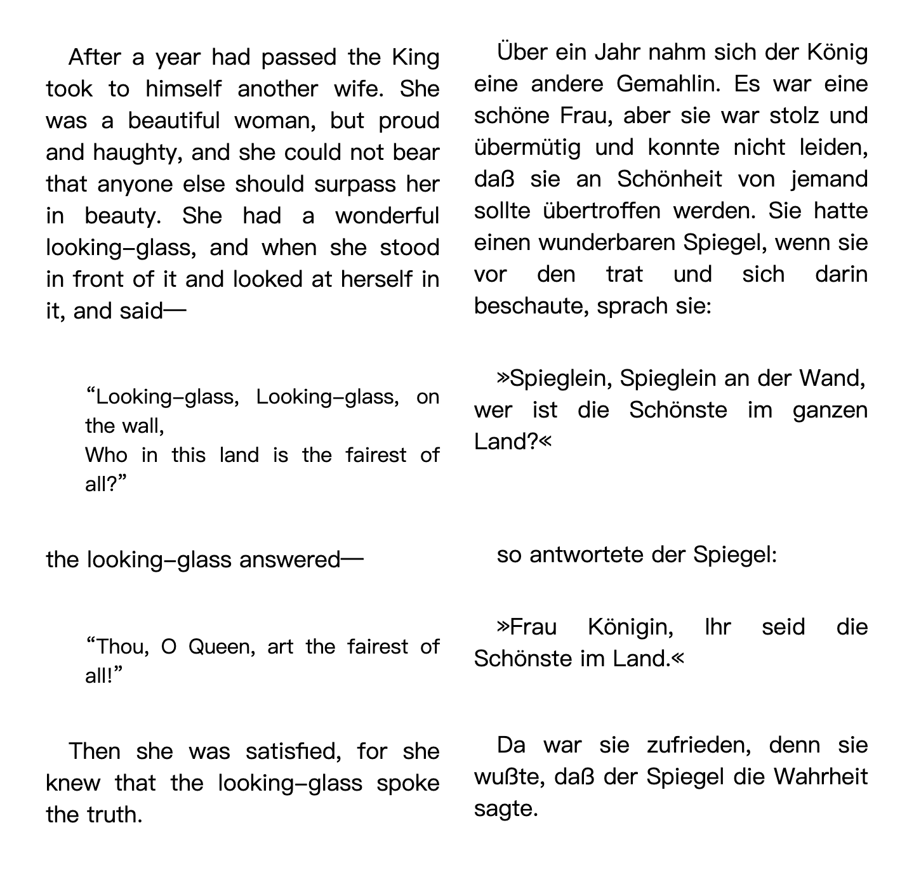
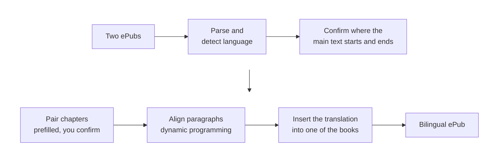

# EpubMerger

Merge a book and its translation into one bilingual ePub, with each paragraph followed by its counterpart in the other language.

<p align="center">
  
</p>

<p align="center">
  <a href="https://epubmerger.pages.dev/"><b>Try it at epubmerger.pages.dev →</b></a>
</p>

- **Your books never leave your browser.** There is no server: reading, aligning and building the new book all happen on your own computer.
- **Free, no account.** Drop in two ePubs, check the chapter list, download.
- **A standard ePub out.** It opens in Apple Books, Kobo, KOReader, Calibre or any other ePub reader.

## What you get

Pick one of two layouts: each translated paragraph sits right under its original, or beside it.

<table>
  <tr>
    <th width="50%">Stacked</th>
    <th width="50%">Two columns</th>
  </tr>
  <tr>
    <td valign="top"></td>
    <td valign="top"></td>
  </tr>
</table>

<sub>From "Little Snow-white" in the Brothers Grimm's fairy tales: Margaret Hunt's English translation (1884) merged with the German original, both public domain and both from <a href="https://www.gutenberg.org/">Project Gutenberg</a> (<a href="https://www.gutenberg.org/ebooks/5314">#5314</a>, <a href="https://www.gutenberg.org/ebooks/77905">#77905</a>). Screenshots are shown in a browser with the book's own styles.</sub>

## How it works



1. **Parse.** Unzip both books, read the table of contents and split every chapter into paragraphs. The language of each book is detected from its text.
2. **Find the main text.** Front matter and back matter (copyright pages, ads, the translator's notes) rarely match between editions. The app guesses where the story starts and ends in each book; you can move either end.
3. **Pair chapters.** Two editions often split chapters differently. The app prefills a chapter table from chapter lengths, and you fix the rows it got wrong by linking cards.
4. **Align paragraphs.** Within each chapter pair, a dynamic program finds the best pairing between the two books' paragraphs. It allows one-to-one, one-to-two, two-to-one and unmatched paragraphs, scoring each option by how well the lengths agree.
5. **Build the book.** The translated paragraphs are inserted after their partners in the first book. Nothing else in that book changes.

All of this runs in a Web Worker, so the page stays responsive while a long book is processed.

## Accuracy

Measured on 3 books that were set aside before any parameters were tuned and never looked at during development: a novel, a popular science book and an academic text, about 2,100 aligned paragraphs in total. The answer key was generated from our output and then corrected by hand. Scores are strict F1: a pairing only counts if it matches the answer key exactly.

| Method                                                        | Strict F1 |
| ------------------------------------------------------------- | --------- |
| Gale-Church (1993), the classic length-based aligner          | 94.5%     |
| **Our length heuristic (what the website uses)**              | **95.0%** |
| Length + multilingual sentence embeddings (command line only) | 96.5%     |

Three books is a small sample, so read these as a rough guide rather than a guarantee.

The website uses only the length heuristic. Adding sentence embeddings ([multilingual-e5-small](https://huggingface.co/intfloat/multilingual-e5-small)) gains about 1.5 points, but every visitor would first have to download a model of about 120 MB. For now that trade isn't worth it. The embedding mode is still available in the command-line tool.

## Design decisions

- **Everything runs in the browser.** No upload means no file storage, no risk of hosting copyrighted books, and hosting costs close to zero. The price is that all the work has to fit in a browser tab, which ruled out large models (see above).
- **Paragraphs, not sentences.** Alternating sentence by sentence chops a page into fragments and makes it tiring to read. Paragraphs are also far easier to align reliably, because translators often split and merge sentences.
- **Chapter pairing is prefilled, then you confirm it.** Automatic chapter matching is sometimes wrong, and a wrong pairing silently ruins everything after it. Spending a few seconds on the chapter table is better than getting a book that quietly goes off track halfway through.
- **Only insert, never rewrite.** The new book is the first book with translated paragraphs added in. Its layout, styles and images are left exactly as they were, so the output looks like the book you started with.

## Tech stack

- **Language:** TypeScript throughout
- **Web app:** React 19, Vite, Tailwind CSS, comlink (Web Worker calls)
- **ePub handling:** fflate (zip), htmlparser2 (XHTML and XML), franc-min (language detection)
- **Command line and evaluation:** Node, Transformers.js (sentence embeddings)
- **Tests:** Vitest, run in Node and in a real browser
- **Hosting:** Cloudflare Pages, with [Umami](https://umami.is/) for anonymous usage counts and [Sentry](https://sentry.io/) for error reports. Neither ever sees book titles or content; see the [privacy page](https://epubmerger.pages.dev/#privacy).

## Run locally

Requires Node 22 or later and [pnpm](https://pnpm.io/).

```bash
pnpm install
```

Start the website at http://localhost:5173:

```bash
pnpm web
```

Merge two books from the command line (add `--length` to skip downloading the embedding model):

```bash
pnpm cli merge en.epub zh.epub -o out.epub
```

Run type checks, lint, formatting and tests:

```bash
pnpm check
```

## Project layout

| Package         | What it does                                                                                                                                                                         |
| --------------- | ------------------------------------------------------------------------------------------------------------------------------------------------------------------------------------ |
| `packages/core` | Parsing, language detection, chapter and paragraph alignment, building the ePub. Plain TypeScript with no Node or browser dependencies, so the website and the command line share it |
| `packages/web`  | The website                                                                                                                                                                          |
| `packages/cli`  | Command-line tool                                                                                                                                                                    |
| `packages/lab`  | Evaluation scripts used to produce the numbers above                                                                                                                                 |

## Limitations

- Only English and Simplified Chinese have been tested. Other languages get a warning; right-to-left languages are not supported.
- Reflowable ePubs only. Books with DRM can't be opened.
- Books with no usable table of contents need more manual fixing in the chapter table.

## Feedback

Found a book that doesn't work? Please [open an issue](https://github.com/Ashx-xhsA/EpubMerger/issues).
